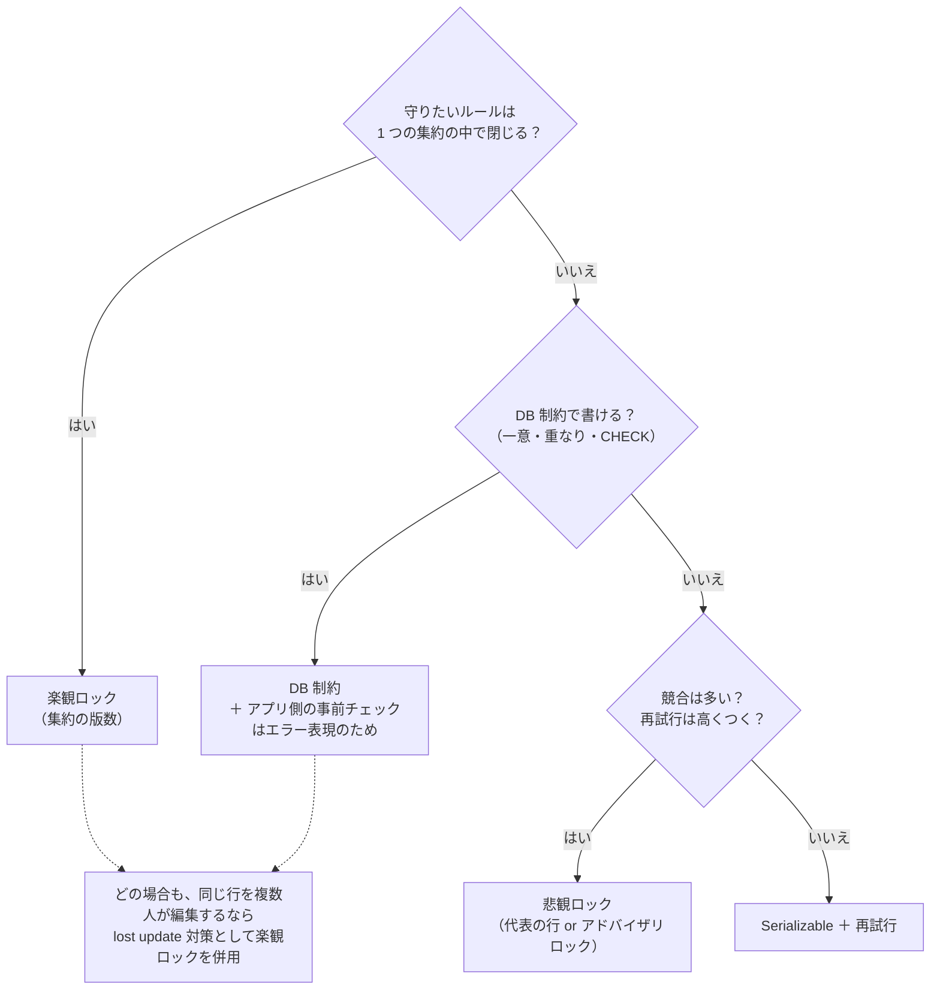

# 講義ノート: 楽観ロックと排他制御

2026-10-23 / ADR-0001 の検討から派生

## 結論: 何で使い分けるか

「基本は楽観ロック、集約が見つからないときだけ別の手段」は **半分正解**。正確には、**守りたいルールがどこまでの範囲にかかるか** で選ぶ。

| 守りたいもの | 第一候補 | 例 |
|---|---|---|
| 1 つの集約の中で閉じるルール | 楽観ロック（集約の版数） | 注文の合計金額が上限を超えない |
| 他人の変更を黙って上書きしないこと（lost update） | 楽観ロック | 2 人が同じ予約のメモを同時に編集する |
| 多数の行にまたがる「集合のルール」で、DB 制約で書けるもの | DB 制約（一意制約・排他制約・CHECK） | メールアドレスが重複しない、予約の時間帯が重ならない |
| 集合のルールで、DB 制約で書けないもの | 悲観ロック（代表の行をロック）か Serializable | 1 人が 1 日に予約できるのは 3 件まで |

楽観ロックと DB 制約は **別の問題を解く道具** なので、併用することが多い。DB 制約は「行と行の関係」を守り、楽観ロックは「1 つのまとまりへの同時更新」を守る。

## 用語の整理

**排他制御**（concurrency control）は、同時に動く処理同士がデータを壊さないようにする仕組みの総称。**排他制約**（exclusion constraint）は PostgreSQL の制約の 1 つで、排他制御の手段の 1 つにすぎない。名前が似ているので混同しやすい。

| 手段 | 考え方 | 衝突したときの結果 |
|---|---|---|
| 楽観ロック | ロックせずに読み、書くときに「読んだ後に誰かが変えていないか」を版数で確かめる | 後から書いた方が失敗する → 読み直して再試行 |
| 悲観ロック | 読む時点でロックし、終わるまで他人を待たせる（`SELECT ... FOR UPDATE`） | 後から来た方が待たされる |
| DB 制約 | 書き込みのたびに、DB 自身がテーブル全体を見てルール違反を拒否する | 違反した方の書き込みが失敗する |
| Serializable | DB が「順番に実行したのと同じ結果になるか」を監視する | 矛盾が起きそうなトランザクションが失敗する（SQLSTATE `40001`）→ 再試行 |

## 楽観ロックの仕組み

まとまり（集約）の行に **版数（version）** を持たせる。全員が同じ 1 行を通ることで、衝突を検出できる。

| 時刻 | X さん | Y さん |
|---|---|---|
| t1 | 読む → version = 3 | |
| t2 | | 読む → version = 3 |
| t3 | `UPDATE ... SET version = 4 WHERE id = ? AND version = 3` → 1 行更新、成功 | |
| t4 | | 同じ UPDATE を `WHERE version = 3` で実行 → 0 行更新、**失敗** |

- 「楽観」とは「たぶん衝突しない」と考えて、読む時点ではロックしないこと。
- 衝突の検出は「中身が矛盾しているか」ではなく「誰かが変えたか」で行う。そのため、無関係な変更同士でも衝突する（**偽の衝突**）。まとまりが大きいほど偽の衝突が増える。これが「集約を小さく保て」の根拠の 1 つ。
- 前提として、**衝突する相手が同じ行を更新する** 必要がある。新しい行の INSERT 同士は、どの既存の行も更新しないので検出できない。
- EF Core では、版数のプロパティを同時実行トークンとして設定すると、0 行更新のときに `DbUpdateConcurrencyException` が投げられる。PostgreSQL ではシステム列 `xmin` を版数として使える（設定方法は Npgsql のバージョンで変わるので、実装時に確認する）。

向いている場面: 衝突がまれ、1 つのまとまりの中で閉じる、ユーザーが画面で考えている間もロックを持ちたくない（Web アプリの大半）。

### 衝突したら自動で再試行してよいか

楽観ロックが失敗させるのは **最初の保存だけ**。自動で再試行すると、最新の状態を読み込み直して操作をもう一度適用するので、その保存は成功する。再試行してよいかどうかは、見せ方の好みではなく **操作の性質** で決まる。

基準: **ユーザーの判断が、古いデータを見たことに依存していたか。**

| | 意図（コマンド）型 | 状態の上書き型 |
|---|---|---|
| 例 | 「13〜14 時を予約する」「在庫を 1 つ減らす」 | 「予約の時間を 10〜11 時から 10〜12 時に変える」「メモを A から B に書き換える」 |
| ユーザーが決めたこと | 何をしたいか | 画面に見えていた状態を、この内容にする |
| 最新の状態でやり直すと | 意図はそのまま有効。ルール違反ならドメインのチェックが弾く | その間に他人がした変更が、黙って消える |
| 衝突したとき | **自動で再試行してよい** | **再試行せず、ユーザーに見せる** |

上書き型で自動再試行すると何が起きるか（予約の時間変更の例）:

| 時刻 | あなた | 共同主催者 |
|---|---|---|
| t1 | 「10〜11 時」の予約を開く | |
| t2 | | 同じ予約を「14〜15 時」に移して保存 → 成功 |
| t3 | 「10〜12 時」に変えて保存 → 版数の不一致で失敗 | |
| t4 | （自動で再試行）最新の「14〜15 時」を読み込み、「10〜12 時にする」を適用して保存 → **成功** | |

最終的に 10〜12 時が保存され、共同主催者の 14〜15 時が消える。あなたは 14〜15 時に移されていたことを一度も見ておらず、共同主催者は自分の変更が消えたことを知らない。楽観ロックが検出した衝突を、自動再試行が握りつぶして lost update を起こしている。

上書き型で衝突したときの見せ方は、要件に応じて選べる。

- **エラーにして読み直してもらう**: 「他の人が 14:00〜15:00 に変更しました。最新の内容を表示します」。最も単純。
- **差分を見せてマージしてもらう**: Wiki やドキュメント編集のような見せ方。手間がかかる。
- **後勝ち（Last Write Wins）**: 業務上「最後に保存した人の内容でよい」と言えるなら、楽観ロックを使わないのも正当な選択。その場合は ADR に残す。

## DB 制約の仕組み

書き込みのたびに、DB が **テーブル全体** に対してルールを確かめる。アプリが何を読んだかに関係なく効く。

- **一意制約**（`UNIQUE`）: 同じ値の行を 2 つ作らせない。
- **排他制約**（`EXCLUDE`、PostgreSQL 固有）: 一意制約の一般化。「`=` で一致する」だけでなく、「`&&` で範囲が重なる」なども条件にできる。

```sql
CREATE EXTENSION IF NOT EXISTS btree_gist;

ALTER TABLE reservations
  ADD CONSTRAINT reservations_no_overlap
  EXCLUDE USING gist (
    room_id WITH =,
    tstzrange(start_at, end_at, '[)') WITH &&
  );
```

「同じ会議室（`=`）で、時間帯が重なる（`&&`）行を 2 つ作らせない」という意味になる。`'[)'` は半開区間なので、10:00〜12:00 と 12:00〜13:00 は重ならない。

楽観ロックでは検出できなかった「INSERT 同士の競合」も、DB 制約なら拒否できる。

| 時刻 | X さん（10〜12 時） | Y さん（11〜13 時） |
|---|---|---|
| t1 | 重なる予約を検索 → 0 件 | |
| t2 | | 重なる予約を検索 → 0 件 |
| t3 | INSERT → 成功 | |
| t4 | | INSERT → **排他制約違反（`23P01`）で失敗** |

向いている場面: ルールが「行と行の関係」で、DB の言葉（等しい、重なる、範囲内）で書ける。

## 悲観ロックと Serializable

DB 制約で書けない集合のルール（例: 「1 人 1 日 3 件まで」）は、件数を数えてから INSERT するしかない。そのままでは t1〜t4 と同じ競合が起きる。対策は 2 つある。

**悲観ロック**: ルールの「代表」となる行を決めて、先にロックする。例: `SELECT * FROM users WHERE id = ? FOR UPDATE` で予約者の行をロックしてから、件数を数えて INSERT する。同じ予約者の処理は 1 本ずつ順番に実行される。

- 代表の行がない場合は、PostgreSQL のアドバイザリロック（`pg_advisory_xact_lock`）で任意のキーをロックできる。
- ロックは短く持つ。ユーザーの操作を待つ間に持ち続けてはいけない。
- 複数の行を別々の順番でロックすると、デッドロックが起きる。

**Serializable**: トランザクション分離レベルを Serializable にすると、PostgreSQL が矛盾を検出して片方を失敗させる。ルールを個別に書かなくてよい汎用的な手段だが、失敗したトランザクションは必ず再試行する必要があり、負荷も高くなる。

## 判断フロー



もう 1 つの選択肢として、「ルール違反を事後に検出して補正する」（結果整合性）もある。業務上、一時的な違反を許せる場合に限られる。会議室の二重予約は許せないので、RoomBooking では使わない。

## RoomBooking への当てはめ

| 場面 | 守りたいもの | 手段 |
|---|---|---|
| 予約の作成 | 同じ会議室で時間帯が重ならない（集合のルール） | 排他制約（ADR-0001） |
| 予約の時間変更（将来） | 時間帯が重ならない ＋ 他人の変更を上書きしない | 重なりは排他制約。同時の変更は楽観ロックで検出し、上書き型なので自動再試行せずユーザーに見せる |
| 予約のメモ等の編集（将来） | 他人の変更を上書きしない | 楽観ロック |
| 予約の取り消し | 本人だけが取り消せる | 認可のチェック。2 回取り消しても結果は同じ（冪等）なので、ロックは不要 |
| 会議室の定員の変更 | 他人の変更を上書きしない | 楽観ロック |

## 確認問題

1. ユーザー登録で「メールアドレスは重複しない」を守りたい。どの手段を選ぶか、理由も添えて。
2. 「在庫数は 0 未満にならない」を守りたい。在庫が 1 商品につき 1 行だとすると、どの手段が候補になるか。
3. 「1 人が 1 日に予約できるのは 3 件まで」を追加することになった。排他制約では書けない。どうするか。

<details>
<summary>解答の方針</summary>

1. 一意制約。行と行の関係（同じ値が 2 つない）で、DB の言葉で書ける。アプリ側の事前チェックは「このアドレスは使われています」と表示するためで、保証は一意制約が担う。
2. 1 行の中で閉じるルールなので、楽観ロックで守れる。さらに単純にするなら、`CHECK (stock >= 0)` と `UPDATE ... SET stock = stock - 1` のように、DB の中で 1 文で減らす方法もある（読んでから書くという隙間ができない）。
3. 集合のルールで、DB 制約では書けない。予約者の行を悲観ロック（`FOR UPDATE`）してから件数を数える方法が素直。競合がまれなら Serializable と再試行でもよい。どちらを選んでも ADR に残す。

</details>
